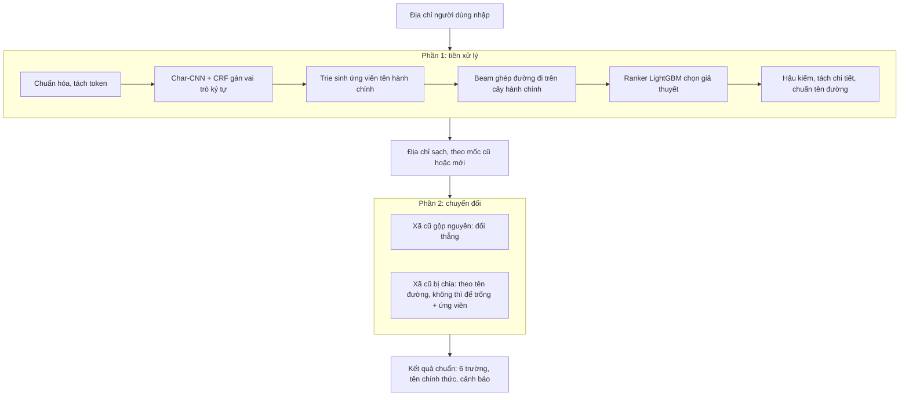

# Tài liệu dự án: chuẩn hóa địa chỉ tiếng Việt theo đơn vị hành chính mới

Cập nhật 05/11/2026. Đề tài môn Xử lý ngôn ngữ tự nhiên, lớp KHMT K22A, nhóm 6.

Tài liệu này mô tả đầy đủ hệ thống đang chạy: bài toán, cách hệ thống xử lý một địa chỉ, dữ liệu, mô hình, cách đánh giá, web, triển khai và cách phát triển tiếp. Các tài liệu chi tiết hơn được dẫn tới ở từng mục.

## Mục lục

1. [Bài toán](#1-bài-toán)
2. [Bắt đầu nhanh](#2-bắt-đầu-nhanh)
3. [Kiến trúc tổng quan](#3-kiến-trúc-tổng-quan)
4. [Phần 1: tiền xử lý](#4-phần-1-tiền-xử-lý)
5. [Phần 2: chuyển đổi](#5-phần-2-chuyển-đổi)
6. [Đầu ra và cảnh báo](#6-đầu-ra-và-cảnh-báo)
7. [Dữ liệu](#7-dữ-liệu)
8. [Mô hình và huấn luyện](#8-mô-hình-và-huấn-luyện)
9. [Đánh giá](#9-đánh-giá)
10. [Web Address May Cry và API](#10-web-address-may-cry-và-api)
11. [Triển khai](#11-triển-khai)
12. [Cấu hình và biến môi trường](#12-cấu-hình-và-biến-môi-trường)
13. [Cấu trúc thư mục](#13-cấu-trúc-thư-mục)
14. [Quy trình phát triển](#14-quy-trình-phát-triển)
15. [Giới hạn và việc còn dở](#15-giới-hạn-và-việc-còn-dở)
16. [Các quyết định chính](#16-các-quyết-định-chính)

---

## 1. Bài toán

Đặc tả gốc: [bai_toan.md](../bai_toan.md).

Từ ngày 01/07/2025, Việt Nam còn 34 tỉnh, bỏ cấp huyện, chỉ còn cấp tỉnh và cấp xã (3.321 xã, phường, đặc khu). Địa chỉ người dùng vẫn ghi theo địa giới cũ, viết tắt, không dấu, sai chính tả, lộn thứ tự. Hệ thống nhận **một chuỗi địa chỉ nhập tự do** và trả về **địa chỉ chuẩn theo đơn vị hành chính mới**.

| Đầu vào có thể gặp | Ví dụ |
|---|---|
| Không dấu, sai dấu | `cau giay`, `Cầu Giâý` |
| Viết tắt | `HN`, `TP.HCM`, `Q.`, `P.`, `ng.`, `kp` |
| Lộn thứ tự, thiếu dấu phẩy | `Thanh Hóa, xã Tiên Trang, số 71` |
| Địa giới cũ | còn quận/huyện, tên xã cũ, tỉnh cũ |
| Thiếu thành phần | không ghi tỉnh, không ghi xã |
| Lẫn ghi chú | `(gọi trước khi giao 0918...)` |

Đầu ra: số nhà, ngõ/ngách/hẻm, thôn/xóm/ấp/tổ dân phố, đường, xã mới (tên và mã), tỉnh mới (tên và mã), địa chỉ chuẩn ghép lại, danh sách cảnh báo, và danh sách xã mới ứng viên khi xã cũ bị chia.

Quy tắc cốt lõi:

- **Thiếu thì để trống, không đoán.** Không đủ căn cứ thì để trống và gắn cảnh báo.
- **Cấp huyện chỉ dùng để xác định**, không xuất ra.
- **Xã cũ bị chia** thành nhiều xã mới: phân giải theo tên đường nếu có bằng chứng; không thì để trống mã xã, gắn cờ `xa_bi_chia` và liệt kê các xã mới có thể.
- **Số nhà, ngõ, thôn, đường không đổi theo luật**: chỉ chuẩn cách viết (`12/5` thành `Số 12/5`, `ng.` thành `Ngõ`, viết hoa đúng).

Ràng buộc: chạy offline trên CPU, **không dùng LLM hay API ngoài khi chạy**; tốc độ quan trọng ngang độ chính xác.

## 2. Bắt đầu nhanh

Môi trường: Python 3.12, môi trường `.venv-neural` (PyTorch CPU, LightGBM, NumPy, openpyxl), xem [requirements-neural.txt](../requirements-neural.txt). Lệnh dưới đây chạy từ gốc repo trong Git Bash; trên PowerShell thay đường dẫn tương ứng.

```bash
PY=.venv-neural/Scripts/python.exe
```

Chuẩn hóa một địa chỉ bằng dòng lệnh (dùng đúng mô hình và từ điển của web):

```bash
$PY -X utf8 -B -c "from src.cau_hinh import tao_bo_chuan_hoa; print(tao_bo_chuan_hoa().chuan_hoa('so 12 ngo 5 tran thai tong cau giay hn').dia_chi_chuan)"
```

Chạy web trên máy (API phục vụ luôn giao diện đã build, cổng 8080):

```bash
cd web/address-may-cry && npm install && npm run build && cd ../..
$PY -X utf8 web/address-may-cry/api/chay_may_chu.py
```

Mở `http://localhost:8080`. Bật ghi log các bước trung gian: đặt `AMC_LOG=1` trước lệnh chạy.

Chạy bằng Docker:

```bash
docker build -t address-may-cry .
docker run -p 8080:8080 address-may-cry
```

Đo theo quy chuẩn:

```bash
$PY -X utf8 -B -m danh_gia.chuan ds
$PY -X utf8 -B -m danh_gia.chuan chay ban_cua_toi
$PY -X utf8 -B -m danh_gia.chuan cham ban_cua_toi
```

Kiểm thử:

```bash
$PY -X utf8 -B -m unittest discover -s tests -p 'test_*.py'
$PY -X utf8 -B -m unittest discover -s web/address-may-cry/api/tests -p 'test_*.py'
```

## 3. Kiến trúc tổng quan

Hệ thống có **đúng hai phần**, đo và báo cáo riêng từng phần:



- **Phần 1, tiền xử lý** (`src/tien_xu_ly/`): chuỗi bẩn thành địa chỉ sạch có cấu trúc. Kết quả có thể theo mốc cũ hoặc mới, tùy chuỗi đầu vào ghi theo mốc nào.
- **Phần 2, chuyển đổi** (`src/chuyen_doi/`): địa chỉ sạch theo mốc cũ thành mốc mới, **chỉ tra bảng đối chiếu**, không học.
- Mặt tiền ghép hai phần: `BoChuanHoa.chuan_hoa(chuoi)` trong [src/chuan_hoa.py](../src/chuan_hoa.py). Mọi nơi dùng mô hình đang chạy (web, CLI, đo) dựng pipeline qua `tao_bo_chuan_hoa()` trong [src/cau_hinh.py](../src/cau_hinh.py), nên số đo luôn là số của đúng bản trên web.

Ví dụ thật (cấu hình hiện tại):

| Đầu vào | Kết quả | Cảnh báo |
|---|---|---|
| `so 12 ngo 5 tran thai tong cau giay hn` | Số 12, Ngõ 5, Phố Trần Thái Tông, Phường Cầu Giấy, Thành phố Hà Nội | `ten_duong_tham_chieu_train_chua_xac_minh` |
| `xom 3, xa Nga Lien, huyen Nga Son, Thanh Hoa` | Xóm 3, Xã Hồ Vương, Tỉnh Thanh Hóa | |
| `268/10 NGUYỄN VĂN LINH, PHƯỜNG XUÂN KHÁNH QUẬN NINH KIỀU, TP CẦN THƠ` | Số 268/10, Đường Nguyễn Văn Linh, Phường Ninh Kiều, Thành phố Cần Thơ | `so_nha_can_duyet`, `loai_duong_suy_tu_crf` |
| `Số nhà 3, phố Tô Vĩnh Diện, phường Khương Trung, quận Thanh Xuân, Hà Nội` | Mã xã để trống, tỉnh Hà Nội; ứng viên: Phường Phương Liệt, Phường Khương Đình | `xa_bi_chia` |
| `Số 43 Phường Mỹ Thạnh Thành phố Long Xuyên gặp chị Hoa 0903112233` | Số 43, Phường Mỹ Thới, Tỉnh An Giang | `phan_chua_phan_loai`, `thieu_tinh_dau_vao` |
| `duong Le Loi` | Đường Le Loi | `thieu_xa`, `thieu_tinh`, `ten_chi_tiet_chua_xac_minh_dau` |

## 4. Phần 1: tiền xử lý

Điều phối: `BoLamSach` trong [src/tien_xu_ly/lam_sach.py](../src/tien_xu_ly/lam_sach.py).

### 4.1 Chuẩn hóa chuỗi và tách token

[tien_xu_ly.py](../src/tien_xu_ly/tien_xu_ly.py): chuẩn Unicode NFC, tách token có giữ vị trí ký tự gốc (để mọi kết quả truy được về đoạn đã nhập), gỡ phím Telex sót (`Huwng` thành `Hung`), tách chữ loại dính số (`p12`, `q3`), bỏ dấu để so khớp (`bo_dau`). Từ vựng chữ loại hành chính và chi tiết (Phường, P., Q., Thôn, Xóm, Kp, Tổ dân phố, Ngõ, Hẻm, Kiệt...) ở [quy_tac.py](../src/tien_xu_ly/quy_tac.py).

### 4.2 Char-CNN + CRF: gán vai trò từng ký tự

[char_cnn.py](../src/tien_xu_ly/char_cnn.py), nhãn ở [nhan.py](../src/tien_xu_ly/nhan.py).

- **7 vai trò**: `so_nha`, `ngo_ngach_hem`, `thon_xom`, `duong`, `xa`, `huyen`, `tinh`; gán theo lược đồ BIO nên có 15 nhãn (O và B-/I- cho mỗi vai trò).
- **Mạng**: embedding ký tự 64 chiều, CNN tích chập giãn có kết nối tắt (residual dilated CNN), 96 kênh, độ giãn 1, 2, 4, 8, 16, 32 (nhìn được ngữ cảnh rộng mà vẫn nhẹ), dropout 0,15. Tổng **355.006 tham số**, từ vựng 215 ký tự, file 1,4 MB.
- **CRF tuyến tính** phía trên, có ràng buộc BIO (không cho nhãn I- đứng sau nhãn khác vai trò), giải mã Viterbi.
- Chạy CPU 1 luồng. CNN chỉ **gợi ý vai trò**; nó không tự quyết tên chuẩn hay mã hành chính.

[ngu_canh_neural.py](../src/tien_xu_ly/ngu_canh_neural.py) chuyển kết quả CNN thành lưới token và điểm vai trò cho các bước sau. [crf_chi_tiet.py](../src/tien_xu_ly/crf_chi_tiet.py) là bộ CRF cũ (python-crfsuite), còn giữ để tham chiếu, không dùng trong cấu hình hiện tại.

### 4.3 Trie: sinh ứng viên tên hành chính

[tim_kiem.py](../src/tien_xu_ly/tim_kiem.py), [tra_cuu_neural.py](../src/tien_xu_ly/tra_cuu_neural.py).

Trie lưu tên tỉnh, huyện, xã của **cả hai cây** (cũ và mới), các dạng bỏ dấu, viết tắt và 4.021 tên cũ/bí danh ([data/ten_cu](../data/ten_cu)). Mỗi đoạn token được thử khớp theo các kiểu, ghi lại kiểu khớp để ranker cân nhắc:

| Kiểu khớp | Ví dụ |
|---|---|
| Chính xác | `Cầu Giấy` |
| Không dấu | `cau giay` |
| Viết tắt chữ đầu | `CG`, `HN`, `HCM` |
| Sai chính tả (sai 1 ký tự) | `cau giaj` |
| Khác dấu | `Cầu Giâý` |
| Khác loại | ghi `phường` cho đơn vị thật là `xã` |

Ứng viên cũng được mở rộng trên các đoạn mà CNN gán vai trò hành chính, có giới hạn số lượng (vượt giới hạn thì gắn `ung_vien_tra_cuu_bi_gioi_han`).

### 4.4 Beam: ghép đường đi hợp lệ trên cây hành chính

[giai_ma.py](../src/tien_xu_ly/giai_ma.py), cây dựng ở [danh_muc.py](../src/danh_muc.py).

Beam search (độ rộng 40) ghép các ứng viên thành "đường đi" tỉnh - huyện - xã **hợp lệ** trên cây: xã phải thuộc huyện, huyện thuộc tỉnh. Mốc (cũ, mới, hay trộn tỉnh mới với xã cũ) không bị khóa cho cả chuỗi. Mỗi đường đi kèm các đoạn còn lại để tách chi tiết thành một **giả thuyết**.

### 4.5 Ranker: chọn giả thuyết

[xep_hang.py](../src/tien_xu_ly/xep_hang.py). LightGBM LambdaRank chấm điểm các giả thuyết của cùng một địa chỉ bằng **28 đặc trưng**: điểm tay ban đầu, số token, số đơn vị hành chính và độ phủ, số token chưa hiểu, số và độ phủ trường chi tiết, số xã/tỉnh đích có thể, có tỉnh/huyện/xã/số nhà/ngõ/thôn/đường hay không, số đơn vị có chữ loại, số lần khớp theo từng kiểu (chính xác, không dấu, viết tắt, sai chính tả, khác dấu, khác loại), điểm vai trò từ CNN, ứng viên có chữ loại bị bỏ qua. Không đưa mã địa phương vào đặc trưng.

Ranker gắn chặt với CNN và danh mục: `ranker.json` lưu danh sách đặc trưng, mã băm CNN (`extractor_sha256`) và mã băm danh mục; nạp sai cặp thì báo lỗi ngay.

### 4.6 Các bước sau ranker: không chọn bừa

Trong [lam_sach.py](../src/tien_xu_ly/lam_sach.py), sau khi ranker chấm điểm:

- Bỏ giả thuyết **đảo thứ bậc** (xóm, huyện rồi mới đến xã) khi có giả thuyết đúng thứ bậc giải thích được ít nhất ngần ấy.
- Lấy nhóm giả thuyết **gần điểm nhất** (chênh dưới 0,05), rồi chạy bốn bước có tên:
  1. `_uu_tien_ten_hien_hanh`: tên hiện hành thắng tên cũ khi điểm gần bằng.
  2. `_thay_bang_mo_rong_nhat_quan`: nếu có giả thuyết giải thích thêm phần ranker bỏ qua mà không đổi mã kết quả, dùng nó.
  3. `_them_gia_thuyet_tuong_duong`: thêm các cách hiểu có bằng chứng ngang nhau (ví dụ tên trùng ở nhiều nơi) để phần chuyển đổi biết câu còn mơ hồ, **không chọn bừa** giữa chúng.
  4. `_chon_tinh`: chỉ chọn mã tỉnh khi mọi giả thuyết trong nhóm cùng chỉ về một tỉnh mới.

### 4.7 Tách chi tiết và chuẩn tên đường

[tach_phan_con.py](../src/tien_xu_ly/tach_phan_con.py), [dinh_dang.py](../src/tien_xu_ly/dinh_dang.py), [phuc_hoi_duong.py](../src/tien_xu_ly/phuc_hoi_duong.py), [chuan_ten_duong.py](../src/tien_xu_ly/chuan_ten_duong.py).

- Phần không phải hành chính được tách thành số nhà, ngõ, thôn, đường theo vai trò CNN và luật có ngữ cảnh, rồi định dạng: thêm chữ loại khi người dùng không ghi (`Số`, `Đường`, tùy chọn `tien_to_mac_dinh`), viết hoa, giữ nguyên chữ người gõ.
- **Từ điển đường** ([data/train/tu_dien_train.json](../data/train/tu_dien_train.json), 1.018 mục): tra **theo tỉnh đã chọn** để thêm dấu và mở rộng viết tắt khi chỉ có một kết quả trong tỉnh. Đoán gần đúng tên đường gõ sai chỉ dùng cho đoạn CNN đã gán là đường, ngưỡng chặt, luôn kèm cảnh báo `ten_duong_doan_gan_dung`. Từ điển này đến từ dữ liệu train, chưa phải danh mục đường đã xác minh, nên tên tra được kèm `ten_duong_tham_chieu_train_chua_xac_minh`.
- **Bảo vệ ranh giới đường** (`bao_ve_duong=True`): không để tên đường bị nuốt nhầm thành tên hành chính.
- **Chẩn đoán**: `BoChuanHoa.chuan_hoa_chan_doan()` trả kèm các bước trung gian (vai trò CNN, ứng viên, giả thuyết, khôi phục đường), dùng khi bật `AMC_LOG=1`.

## 5. Phần 2: chuyển đổi

[src/chuyen_doi/doi_chieu.py](../src/chuyen_doi/doi_chieu.py). Chỉ tra bảng, không học.

- Bảng đối chiếu xã cũ sang xã mới: [data/clean/doi_chieu_xa_cu_moi.csv](../data/clean/doi_chieu_xa_cu_moi.csv), 10.569 dòng, mốc 01/07/2025.
- **Xã cũ gộp nguyên** vào một xã mới: đổi thẳng.
- **Xã cũ bị chia** ra nhiều xã mới: tra [bảng phân giải theo tên đường](../data/xa_chia_theo_duong/bang_xa_chia_theo_duong.csv) (197 dòng, 66 xã, dựng từ OSM + ranh giới; tra cả tên gần đúng). Có bằng chứng thì chọn xã mới và gắn `xa_chia_suy_tu_duong`; không thì **để trống mã xã**, gắn `xa_bi_chia` và trả `xa_moi_ung_vien`.
- Nhiều cách hiểu cho ra đáp án khác nhau: để trống, gắn `nhieu_cach_hieu` (hoặc `mo_ho_moc_cu_moi` khi tên dùng được ở cả hai mốc).
- Tỉnh cũ luôn gộp nguyên vào đúng một tỉnh mới.
- Ghép địa chỉ chuẩn theo thứ tự: số nhà, ngõ, thôn, đường, xã, tỉnh.

## 6. Đầu ra và cảnh báo

Kiểu `KetQua` trong [src/kieu_du_lieu.py](../src/kieu_du_lieu.py):

| Trường | Ý nghĩa |
|---|---|
| `so_nha`, `ngo_ngach_hem`, `thon_xom`, `duong` | Chi tiết, đã chuẩn cách viết |
| `xa_phuong`, `ma_xa` | Tên chính thức và mã xã mới (trống khi không đủ căn cứ) |
| `tinh`, `ma_tinh` | Tên chính thức và mã tỉnh mới |
| `dia_chi_chuan` | Địa chỉ ghép lại |
| `canh_bao` | Danh sách mã cảnh báo |
| `xa_moi_ung_vien` | Các xã mới có thể khi xã cũ bị chia |
| `dau_vet` | Mỗi đơn vị/trường lấy từ đoạn nào của chuỗi gốc |
| `phan_chua_phan_loai` | Phần chữ hệ thống không xếp được vào trường nào |

Mã cảnh báo thường gặp:

| Mã | Nghĩa |
|---|---|
| `thieu_xa`, `thieu_tinh` | Kết quả không có xã / tỉnh |
| `thieu_tinh_dau_vao` | Chuỗi không ghi tỉnh, tỉnh được suy từ xã/huyện |
| `xa_bi_chia` | Xã cũ bị chia, không đủ căn cứ chọn xã mới; xem `xa_moi_ung_vien` |
| `xa_chia_suy_tu_duong` | Xã cũ bị chia, xã mới được chọn theo tên đường |
| `nhieu_cach_hieu`, `mo_ho_moc_cu_moi` | Câu có nhiều cách hiểu ngang bằng chứng; không chọn bừa |
| `khong_co_doi_chieu` | Không có dòng đối chiếu cho xã cũ |
| `don_vi_ghi_khong_khop` | Xã ghi không thuộc huyện ghi; vẫn trả xã, kèm cảnh báo |
| `mau_thuan_hanh_chinh` | Các đơn vị hành chính trong chuỗi mâu thuẫn nhau |
| `khop_gan_dung`, `dau_ten_khac_danh_muc`, `loai_hanh_chinh_khac_danh_muc` | Tên hành chính khớp nhờ sửa lỗi gõ / dấu / chữ loại |
| `phan_chua_phan_loai` | Còn chữ chưa xếp được (thường là ghi chú, số điện thoại) |
| `ten_duong_tham_chieu_train_chua_xac_minh` | Tên đường lấy từ từ điển train, chưa xác minh |
| `ten_duong_doan_gan_dung` | Tên đường được đoán từ chữ gõ sai |
| `ten_duong_viet_tat_chua_giai` | Tên đường viết tắt chưa giải được |
| `ten_chi_tiet_chua_xac_minh_dau` | Tên chi tiết không dấu, không thêm dấu được |
| `loai_duong_suy_tu_crf`, `duong_suy_tu_vi_tri` | Đoạn được hiểu là đường nhờ CNN / nhờ vị trí trong câu |
| `so_nha_can_duyet` | Số nhà dạng `12/5` có nhiều cách hiểu (nhà/ngõ) |
| `ung_vien_tra_cuu_bi_gioi_han` | Quá nhiều ứng viên, đã cắt bớt |

Trên web, trạng thái `needs_review` được bật khi có cảnh báo, có nhiều xã ứng viên, có phần chưa phân loại, hoặc thiếu mã xã/tỉnh.

## 7. Dữ liệu

| Thư mục | Nội dung | Lên git |
|---|---|---|
| [data/clean](../data/clean) | Danh mục hành chính mốc 01/07/2025: 34 tỉnh mới, 3.321 xã mới; 63 tỉnh, 696 huyện, 10.033 xã cũ; bảng đối chiếu 10.569 dòng. Script làm sạch và kiểm tra ở `data/clean/scripts` | Có |
| [data/ten_cu](../data/ten_cu) | 4.021 tên cũ/bí danh huyện, xã (từ vietnamadminunits, MIT) | Có |
| [data/xa_chia_theo_duong](../data/xa_chia_theo_duong) | Bảng phân giải xã bị chia theo tên đường, 197 dòng, 66 xã | Có |
| [data/duong](../data/duong) | Danh mục đường thu thập (v1) | Có |
| [data/train](../data/train) | `train.csv` 4.564 câu (2.964 sinh từ danh mục + 1.600 OSM), bộ train v3, `tu_dien_train.json` | Có |
| [data/dev](../data/dev) | `dev_goc` 1.136 câu, `dev_kho` 464 câu; `nhan_sua/` là nhãn đã sửa dùng để chấm | Có |
| [data/test](../data/test) | 400 địa chỉ OSM, nhãn AI chưa người duyệt ([README](../data/test/README.md)) | Có |
| [data/duoi_xa](../data/duoi_xa) | Cổng kiểm dữ liệu dưới xã do agy thu thập | Có |
| `rieng/bo_kho` | Bộ khó 1.500 câu, đáp án giữ kín | Không |
| `rieng/vang` | Tập vàng AI 300 địa chỉ ngoài OSM | Không |
| `rieng/du_lieu_duoi_xa` | Dữ liệu thôn/tổ/đường do 9 luồng agy thu thập từ văn bản | Không |
| `rieng/tham_chieu_so_nha_toan_quoc` | OSM toàn quốc, ranh giới 3.321 xã mới (GeoJSON), địa chỉ bổ sung từ cổng dữ liệu mở | Không |

Nguồn và giấy phép: dữ liệu OSM theo ODbL 1.0 (© OpenStreetMap contributors); tên cũ từ vietnamadminunits (MIT); ranh giới xã từ thanglequoc/vietnamese-provinces-database (nguồn gốc hình học cần kiểm tra trước khi phân phối). Thư mục `rieng/` và `luu_tru/` không bao giờ lên git (hook `danh_gia/v3/hooks/pre-commit` chặn).

## 8. Mô hình và huấn luyện

Mô hình đang dùng: [mo_hinh/thu_nghiem/char_v3_tc](../mo_hinh/thu_nghiem/char_v3_tc) gồm `char_cnn.pt` (CNN) và `ranker.txt` + `ranker.json` (ranker).

Dữ liệu train CNN v3_tc: dữ liệu thật của bản v2 nhân đôi, 9.992 địa chỉ bẩn do agy sinh có nhãn từng ký tự (kiểm bằng máy), 4.000 dòng tăng cường dạng số nhà thật (dải số, nhiều số, mã lô, căn hộ, Km). Không dùng dev. Ranker train trên 1.134 nhóm giả thuyết, học bằng LambdaRank (100 vòng, 15 lá, độ sâu 4).

Train lại:

```bash
bash danh_gia/v3/train_va_do.sh <ten_run>          # chuẩn bị dữ liệu -> CNN -> ranker -> đo
$PY -X utf8 -B -m danh_gia.huan_luyen_char --run-dir rieng/train_v3/<ten_run> --stage ranker   # chỉ train lại ranker
```

Thư mục chạy nằm trong `rieng/train_v3/`. Đổi CNN thì phải train lại ranker (ranker kiểm mã băm CNN). Quay về bản trước: trỏ `src/cau_hinh.py` sang `mo_hinh/thu_nghiem/char_v2_01`.

Các hướng đã thử và bỏ (ViDeBERTa, PhoBERT, train thêm 15.000 câu OSM...) ghi trong [TONG_KET.md](../TONG_KET.md) mục 3.

## 9. Đánh giá

Quy chuẩn đầy đủ: [danh_gia/chuan/QUY_CHUAN.md](../danh_gia/chuan/QUY_CHUAN.md). **Mọi số báo cáo và mọi quyết định thay đổi chỉ dùng bộ này.**

Năm bộ dữ liệu, mỗi bộ một vai trò, không gộp số (`python -m danh_gia.chuan ds` để xem mô tả đầy đủ):

| Mã | Tên | Số câu | Vai trò |
|---|---|---|---|
| `dev_osm_that` | Dev: địa chỉ OSM thật | 400 | Số chính, chọn cấu hình |
| `dev_sinh_danh_muc` | Dev: địa chỉ sinh từ danh mục hành chính | 1.200 | Kiểm hồi quy |
| `kho_bien_the_ban` | Bộ khó: biến thể bẩn của địa chỉ | 1.500 | Kiểm độ bền |
| `test_osm_nhan_ai` | Test: địa chỉ OSM thật, nhãn AI chưa người duyệt | 400 | Tham khảo |
| `vang_ngoai_osm_ai` | Vàng: địa chỉ thật ngoài OSM, AI duyệt | 247 | Xác nhận khi chốt phiên bản |

Một quy ước chấm cho mọi tập (bỏ dấu; chữ loại thiếu một bên không bị bắt lỗi; Đường = Phố). Chỉ số: đúng đủ 6 trường kèm khoảng tin cậy 95%, từng trường, **khẳng định sai mã xã**, độ chính xác khi khẳng định, độ phủ, **điền thừa**, xã bị chia, tốc độ; báo theo nhóm (đô thị/nông thôn, có thôn, địa chỉ cũ...). So hai phiên bản bằng phép kiểm McNemar trên từng câu, phán quyết LOẠI / NHẬN mạnh / NHẬN yếu / TRUNG TÍNH.

Số hiện tại (char_v3_tc + tu_dien_train):

| Tập | Đúng đủ 6 trường (KTC 95%) | Khẳng định sai mã xã |
|---|---|---|
| Dev OSM thật (số chính) | **86,8%** (83,1–89,7) | 3,0% |
| Dev sinh từ danh mục | 97,2% | 0% |
| Bộ khó | 86,9% | 0,9% |
| Test OSM nhãn AI | 69,8% | 9,2% |
| Vàng ngoài OSM, AI duyệt | **82,2%** (76,9–86,5) | 2,0% |

Đọc số cho đúng: dev đã được dùng để chọn cấu hình; bộ khó cùng nguồn agy với train; test và vàng là nhãn AI. Với 400 câu, khoảng tin cậy rộng khoảng ±3 điểm, chênh vài câu không phân biệt được. Con số 94,2% trong các báo cáo cũ gộp 736 câu sinh tự động (đúng 98,1%) nên không dùng làm số chính.

Tốc độ: khoảng 75–90 ms/câu trung vị trên laptop (CPU 1 luồng), p95 khoảng 160 ms. Trên Render gói miễn phí (0,1 CPU) khoảng 0,7 giây/câu.

## 10. Web Address May Cry và API

Thư mục [web/address-may-cry](../web/address-may-cry): giao diện React 18 + TypeScript + Vite; API Python thuần (`http.server`), phục vụ luôn giao diện đã build.

Giao diện có ba tab:

- **Một địa chỉ**: nhập, `Ctrl + Enter` để chạy, ví dụ mẫu; kết quả hiện bảng từng thành phần (đoạn gốc, vai trò, giá trị chuẩn) và hai dòng địa chỉ sau tiền xử lý / sau chuyển đổi; nút báo kết quả sai.
- **Hàng loạt**: dán danh sách hoặc tải tệp CSV (tối đa 5 MB), tối đa 1.000 dòng mỗi lần, gửi theo lô 20 địa chỉ, lọc các dòng cần xem lại.
- **File Excel**: chọn cột địa chỉ trong file `.xlsx`, chạy nền, theo dõi tiến độ, tải file kết quả.

API (hợp đồng: [CONTRACT.md](../web/address-may-cry/CONTRACT.md)):

| Phương thức | Đường dẫn | Mô tả |
|---|---|---|
| GET | `/api/v1/health` | Trạng thái engine (`ok`/`loading`/`error`), giới hạn |
| POST | `/api/v1/normalize` | `{address}` (tối đa 2.048 ký tự) trả kết quả một địa chỉ |
| POST | `/api/v1/batch` | `{addresses:[{id,address}]}` tối đa 100 phần tử |
| POST | `/api/v1/feedback` | Người dùng báo kết quả sai (chỉ ghi khi `AMC_LOG=1`) |
| POST | `/api/v1/excel/xem` | Xem trước các cột của file Excel |
| POST | `/api/v1/excel/chay` | Chạy chuẩn hóa một cột, trả mã công việc |
| GET | `/api/v1/excel/tien_do?job=` | Tiến độ công việc |
| GET | `/api/v1/excel/tai?job=` | Tải file kết quả |

Engine ([engine.py](../web/address-may-cry/api/engine.py)) là singleton, khóa luồng khi chạy mô hình, **cache LRU 5.000 kết quả** theo đúng chuỗi đầu vào (nạp sẵn 5 ví dụ mẫu; tắt bằng `AMC_CACHE=0`; tự bỏ qua khi bật log). Log phiên (khi `AMC_LOG=1`) ghi ở `web/address-may-cry/api/logs/phien_YYYYMMDD.jsonl`, không lên git vì chứa địa chỉ người dùng.

## 11. Triển khai

- **Docker** ([Dockerfile](../Dockerfile)): tầng 1 build giao diện bằng Node 22; tầng 2 Python 3.12 slim với torch CPU, numpy, lightgbm, openpyxl; chỉ chép mã, danh mục, mô hình, từ điển; chạy bằng người dùng thường, có health check. Image khoảng 1,75 GB, chạy dùng khoảng 250 MB RAM.
- **Render** ([render.yaml](../render.yaml)): dịch vụ web gói miễn phí ở Singapore, build từ Dockerfile, **tự triển khai mỗi lần push lên `main`**. Địa chỉ: https://address-may-cry.onrender.com.
- **Giữ máy chủ thức**: gói miễn phí ngủ sau 15 phút không có truy cập. [chay_may_chu.py](../web/address-may-cry/api/chay_may_chu.py) tự gọi `/api/v1/health` qua địa chỉ công khai mỗi 10 phút; [workflow GitHub Actions](../.github/workflows/giu_render_thuc.yml) ping thêm làm dự phòng (lịch của GitHub có thể trễ).
- **Hiệu năng trên Render miễn phí** (0,1 CPU): khoảng 0,7 s/địa chỉ mới, khoảng 0,15 s với địa chỉ đã có trong cache (chủ yếu là thời gian đường truyền); 100 địa chỉ một lô khoảng 1 phút. Muốn nhanh hơn cần gói nhiều CPU hơn.

## 12. Cấu hình và biến môi trường

Cấu hình sản phẩm ở một chỗ: [src/cau_hinh.py](../src/cau_hinh.py) (mô hình, từ điển đường, `bao_ve_duong`, `tien_to_mac_dinh`).

| Biến | Mặc định | Tác dụng |
|---|---|---|
| `AMC_TU_DIEN_DUONG` | `data/train/tu_dien_train.json` | Đổi từ điển đường (thử nghiệm) |
| `AMC_LOG` | tắt | `1`: ghi log phiên và các bước trung gian |
| `AMC_CACHE` | `5000` | Số kết quả cache; `0` để tắt |
| `AMC_CODE_ROOT` | gốc repo | Chạy API với mã ở thư mục khác |
| `PORT`, `HOST` | `8080`, `0.0.0.0` | Cổng và địa chỉ nghe của máy chủ |
| `RENDER_EXTERNAL_URL` | Render tự đặt | Địa chỉ công khai để tự ping |
| `TU_PING_GIAY` | `600` | Chu kỳ tự ping; `0` để tắt |
| `CODE_ROOT` | gốc repo | Script đo cũ trong `danh_gia/v3` đo mã ở thư mục khác |

## 13. Cấu trúc thư mục

```
src/                    mã chạy
  cau_hinh.py           cấu hình dùng chung (web = đo)
  chuan_hoa.py          BoChuanHoa: ghép hai phần
  danh_muc.py           nạp danh mục, dựng cây cũ/mới
  kieu_du_lieu.py       KetQua, DonVi, ...
  tien_xu_ly/           phần 1 (lam_sach.py điều phối)
  chuyen_doi/           phần 2 (doi_chieu.py)
mo_hinh/thu_nghiem/     char_v3_tc (đang dùng), char_v2_01, crf_v1_01
data/                   danh mục, train, dev, test, dữ liệu dưới xã
danh_gia/
  chuan/                bộ đánh giá chuẩn + QUY_CHUAN.md
  v3/                   script train/đo v3 (train_va_do.sh, chay_mo_hinh.py...)
  huan_luyen_char.py    train CNN và ranker
web/address-may-cry/    giao diện React + api/ (server, engine, excel_job, nhật ký)
tests/                  kiểm thử
docs/                   tài liệu (file này, hợp đồng nhãn, quy trình duyệt test, thiết kế UI)
bao_cao/                báo cáo môn học (chỉ báo cáo tuần 3 lên git)
rieng/, luu_tru/        không lên git: đáp án kín, dữ liệu lớn, đồ cũ
Dockerfile, render.yaml triển khai
```

## 14. Quy trình phát triển

1. **Làm trên nhánh ngắn**, xong trong ngày thì merge hoặc bỏ; `main` luôn là bản đang chạy trên web (push là Render triển khai lại).
2. **Phân tích ảnh hưởng trước khi sửa** bằng GitNexus (`impact` cho hàm định sửa; `detect_changes` trước khi commit), xem [CLAUDE.md](../CLAUDE.md). Rủi ro HIGH/CRITICAL phải nêu rõ và có kiểm chứng.
3. **Thay đổi không chủ ý đổi kết quả** (dọn mã, đổi cấu trúc): kiểm "giống từng byte" trên dev + bộ khó so với `main`.
4. **Thay đổi có chủ ý đổi kết quả** (mô hình, luật, từ điển): `danh_gia.chuan chay` cho cả hai bản rồi `so_sanh`, ghi phán quyết và lý do vào commit. Tập vàng chỉ chạy khi chốt phiên bản.
5. **Kiểm thử** dự án và API phải đạt trước khi commit.
6. **Bật log khi thử** (`AMC_LOG=1`) và sửa theo nguyên nhân gốc, không vá khớp từng câu.
7. **Dùng agy (Gemini)** cho việc dữ liệu tốn công nhưng kiểm được bằng máy; kết quả agy luôn phải qua cổng kiểm. Hướng dẫn: repo riêng `AnDpTri/agy-huong-dan`.

## 15. Giới hạn và việc còn dở

- **Tách thôn/tổ/khối là điểm yếu lớn nhất**: nhóm có thôn chỉ đạt 74,0% trên tập vàng và 37,5% trên test; dữ liệu train rất ít địa chỉ nông thôn có thôn.
- **Khẳng định sai còn sót**: ví dụ "p. Đông Vệ, Tp. Thanh Hóa" bị chọn sang một phường ở TP.HCM; "Khu Nam Quan" (không ghi xã, tỉnh) vẫn bị gán một xã.
- **Viết tắt bỏ nguyên âm** (`hnoi`, `p.trc bch`) chưa tra được, đang để trống.
- **Ranh giới thôn/xóm khi không có dấu phẩy** còn dở (nhánh lưu trữ `wip/thon-xom-dang-do-20261031`).
- **Lỗi từ log web chưa sửa**: dấu `-` dính vào tên thôn, chữ loại dính viết tắt (`xnt`), chuỗi vô nghĩa vẫn được khẳng định thành một xã, mất tên thôn khi không ghi chữ "thôn".
- **Ranker v3_tc train trên pipeline cũ**: train lại trên mã hiện tại cho kết quả khác; nên train lại và so bằng quy chuẩn.
- **Đặc trưng thôn/đường thuộc xã (cách 2)**: mã đã viết, cất trong `git stash`; chưa đánh giá đúng vì thiếu dữ liệu có thôn.
- **Đánh giá**: chưa có tập vàng do người duyệt; tập vàng hiện tại là nhãn AI, thiên về địa chỉ tổ chức ở các tỉnh có cổng dữ liệu mở.
- **Render miễn phí chậm** (0,1 CPU) và có thể ngủ nếu cơ chế tự ping lỗi.

## 16. Các quyết định chính

| Ngày | Quyết định | Căn cứ |
|---|---|---|
| 29–30/10 | Char-CNN + CRF + LightGBM làm nền; bỏ ViDeBERTa, PhoBERT | ViDeBERTa kém 1–2 điểm, chậm khoảng 7 lần trên CPU |
| 31/10 | Dùng char_v3_tc (thêm dữ liệu bẩn do agy sinh) | Bộ khó 57,2% lên 82,7%, dev giữ nguyên |
| 31/10 | Không chọn bừa giữa cách hiểu ngang bằng chứng | Khẳng định sai mã xã trên test 34 xuống 33 |
| 31/10 | Không train thêm 15.000 câu OSM nhãn từ thẻ | Test 248 xuống 227 câu |
| 04/11 | Triển khai Docker + Render, máy chủ tự ping | Môn Điện toán đám mây; gói miễn phí ngủ sau 15 phút |
| 05/11 | Cache LRU 5.000 kết quả trên web | Câu lặp lại 0,7 s xuống khoảng 0,15 s; kết quả giống hệt trên 300 câu |
| 05/11 | Cấu hình dùng chung web = đo; quy chuẩn đánh giá | Số đo trước đó dùng từ điển khác web, gộp dữ liệu sinh |
| 05/11 | Từ điển đường mặc định `tu_dien_train` thay v5 | v5 bịa tên đường từ ghi chú; bộ khó 15 tốt / 4 kém, p = 0,019 |
| 05/11 | Tập vàng là vàng AI (247 câu ngoài OSM) | Quyết định của nhóm; ghi rõ giới hạn trong quy chuẩn |
